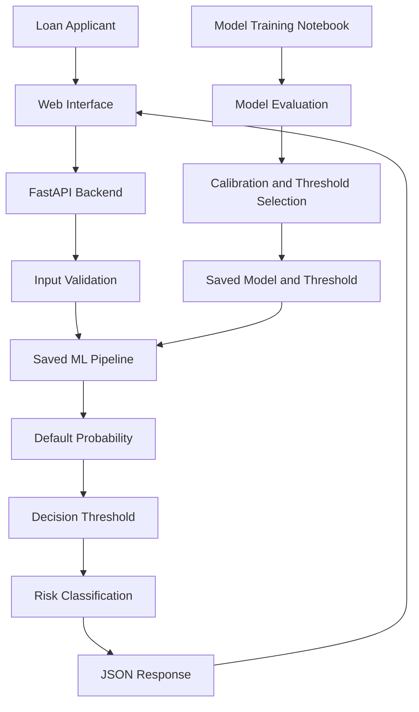

# 🏦 Production-Ready Credit Risk Prediction System

### An End-to-End Machine Learning Application for Loan Default Risk Assessment

An end-to-end credit risk prediction application that estimates the probability of loan default using machine learning. The project combines model development, hyperparameter optimization, probability calibration, decision-threshold tuning, and explainable AI with a FastAPI backend and a web-based frontend.

The goal is to demonstrate how a trained ML model can be taken beyond a notebook and integrated into an application that accepts loan applicant information and returns a risk prediction.

---

## 🚀 Overview

Credit risk assessment is an important part of lending. Predicting whether a borrower is likely to default can help financial institutions evaluate applications more consistently and make better-informed lending decisions.

This project builds a complete workflow around that problem:

- **Machine Learning:** XGBoost-based classification for loan default prediction.
- **Hyperparameter Optimization:** Randomized search with cross-validation.
- **Imbalanced Classification:** Average precision as a model-tuning objective.
- **Decision Threshold Optimization:** Selecting a classification threshold using precision-recall analysis and F1-score.
- **Probability Calibration:** Evaluating and improving the reliability of predicted probabilities.
- **Explainable AI:** SHAP-based feature contribution analysis.
- **REST API:** FastAPI for serving predictions.
- **Web Interface:** HTML, CSS, and JavaScript for interacting with the prediction service.
- **Model Persistence:** Saving the trained model and selected decision threshold for inference.

## ✨ Key Features

| Feature | Description |
|---|---|
| Risk Probability | Estimates the probability of loan default |
| XGBoost Classifier | Captures nonlinear relationships in borrower and loan data |
| Hyperparameter Search | Uses `RandomizedSearchCV` and cross-validation to explore model configurations |
| Precision-Recall Analysis | Evaluates performance with a focus on the default class |
| Threshold Optimization | Converts probabilities into classifications using a selected decision threshold |
| Probability Calibration | Examines whether predicted probabilities align with observed outcomes |
| SHAP Explainability | Helps interpret which features influence model predictions |
| FastAPI Backend | Exposes an API for real-time inference |
| Interactive Frontend | Collects applicant information and presents prediction results |
| Serialized Artifacts | Loads the trained model and threshold without retraining on every request |
| Render Configuration | Includes deployment configuration for a hosted web service |

## 🧠 Machine Learning Workflow

The project follows an end-to-end modeling workflow:

1. **Data Exploration and Preprocessing** — inspect the dataset, understand its features, and prepare data for modeling.
2. **Model Development** — build a classification pipeline using XGBoost and preprocessing components.
3. **Hyperparameter Optimization** — search candidate configurations using randomized search and cross-validation.
4. **Model Evaluation** — evaluate the classifier using metrics appropriate for imbalanced classification.
5. **Threshold Selection** — analyze precision and recall at different thresholds and select a threshold based on F1-score.
6. **Probability Calibration** — compare calibrated and uncalibrated probabilities.
7. **Model Explainability** — use SHAP to investigate feature contributions.
8. **Model Serialization** — save the fitted model and selected threshold.
9. **API Integration** — load the saved artifacts through FastAPI and serve predictions.
10. **Frontend Integration** — allow users to submit applicant details through a web interface.

### Why optimize the decision threshold?

A binary classifier can produce a probability rather than an immediate yes/no decision.

For example, a model might estimate a default probability of `0.42`. Whether that application is classified as high risk depends on the chosen decision threshold.

Instead of automatically using the default threshold of `0.50`, this project explores precision-recall trade-offs and selects a threshold using F1-score.

This makes the classification policy explicit and separates probability estimation from the final risk classification.

> The selected threshold is a modeling decision, not a universal financial rule. In real lending systems, it should also reflect business costs, regulatory requirements, and the consequences of false positives and false negatives.

## 📊 Model Evaluation and Explainability

### Precision-Recall Analysis

Precision measures how many predicted defaults are actual defaults. Recall measures how many actual defaults the model successfully identifies.

These metrics help examine the trade-off between missing risky borrowers and flagging borrowers who would not default.

The project uses average precision during hyperparameter optimization and examines precision-recall behavior when selecting a decision threshold.

### Probability Calibration

A model's ability to rank borrowers by risk is different from its ability to produce reliable probabilities.

Calibration analysis compares predicted probabilities with observed default frequencies. A well-calibrated model should produce probabilities that broadly agree with observed outcomes across groups of predictions.

### SHAP Explainability

SHAP (SHapley Additive exPlanations) helps interpret model outputs by estimating how individual features contribute to a prediction.

It can be used to investigate:

- Which features have the greatest overall influence on predictions.
- How high or low feature values relate to model output.
- Why a particular applicant receives a higher or lower model score.

SHAP explains model behavior; it does not establish causation or, by itself, demonstrate that a lending model is fair.

## 🏗️ System Architecture



The training workflow produces the serialized artifacts. During inference, FastAPI loads these artifacts at application startup and uses them to process incoming loan applications.

## 🛠️ Tech Stack

| Category | Technologies |
|---|---|
| Language | Python |
| Machine Learning | XGBoost, Scikit-learn |
| Data Processing | Pandas, NumPy |
| Model Analysis | Precision-recall analysis, calibration curves, SHAP |
| Backend | FastAPI, Uvicorn |
| Input Validation | Pydantic |
| Model Persistence | Joblib |
| Frontend | HTML, CSS, JavaScript |
| Deployment Configuration | Render |

## 📂 Repository Structure

```text
Production-Ready-Credit-Risk-Prediction-System/
│
├── static/
│   ├── index.html
│   ├── style.css
│   └── script.js
│
├── Credit-Risk-Model.ipynb
├── credit_risk_dataset.csv
├── credit_risk_model.pkl
├── best_threshold.pkl
├── main.py
├── requirements.txt
├── runtime.txt
├── render.yaml
└── README.md
```

### Important Files

- `Credit-Risk-Model.ipynb` — model development, experimentation, evaluation, calibration, threshold selection, and explainability.
- `credit_risk_dataset.csv` — dataset used for the credit-risk modeling workflow.
- `credit_risk_model.pkl` — serialized trained model and preprocessing pipeline.
- `best_threshold.pkl` — saved decision threshold used to classify predicted probabilities.
- `main.py` — FastAPI application, input validation, prediction endpoint, and static frontend serving.
- `static/` — HTML, CSS, and JavaScript files for the web interface.
- `requirements.txt` — Python dependencies.
- `render.yaml` — Render service configuration.
- `runtime.txt` — Python runtime configuration.

## ⚙️ Getting Started

### Prerequisites

- Python version compatible with the serialized model and dependencies.
- Git.
- pip.

### 1. Clone the repository

```bash
git clone https://github.com/krisharora7/Production-Ready-Credit-Risk-Prediction-System.git

cd Production-Ready-Credit-Risk-Prediction-System
```

### 2. Create a virtual environment

```bash
python -m venv .venv
```

Activate it on Windows:

```bash
.venv\Scripts\activate
```

On macOS or Linux:

```bash
source .venv/bin/activate
```

### 3. Install dependencies

```bash
python -m pip install -r requirements.txt
```

**Compatibility note:** Serialized scikit-learn models can depend on the version used during training. Use compatible, pinned dependency versions when loading the saved model.

### 4. Start the application

```bash
uvicorn main:app --reload
```

Open the application in your browser:

- **Web interface:** `http://127.0.0.1:8000/`
- **Interactive API documentation:** `http://127.0.0.1:8000/docs`

The saved model and threshold files must be available at the paths expected by the application.

## 🔌 API Reference

### `POST /predict`

Accepts a loan application as JSON and returns a predicted default probability, threshold-based classification, and risk label.

#### Example request

```json
{
  "person_age": 30,
  "person_income": 60000,
  "person_home_ownership": "RENT",
  "person_emp_length": 5,
  "loan_intent": "PERSONAL",
  "loan_grade": "B",
  "loan_amnt": 10000,
  "loan_int_rate": 12.5,
  "loan_percent_income": 0.17,
  "cb_person_default_on_file": "N",
  "cb_person_cred_hist_length": 6
}
```

This is an illustrative request. The API validates the input types and allowed categorical values defined by the Pydantic request schema.

#### Example response

```json
{
  "default_probability": 0.42,
  "default_prediction": 1,
  "threshold": 0.35,
  "result": "High Risk"
}
```

The response values above are illustrative, not measured results from the saved model.

#### Response fields

| Field | Meaning |
|---|---|
| `default_probability` | Model-estimated probability of default |
| `default_prediction` | `1` if the probability meets or exceeds the threshold; otherwise `0` |
| `threshold` | Decision threshold loaded by the application |
| `result` | Human-readable risk label derived from the classification |

Explore the live API schema locally at `http://127.0.0.1:8000/docs` after starting the server.

## 🔍 Engineering Considerations

This project explores several practical considerations that arise when deploying ML inference:

- **Training versus inference:** training and prediction are separate stages.
- **Preprocessing consistency:** inference must apply the same fitted preprocessing steps used during training.
- **Decision policy:** probability estimation and classification threshold are separate components.
- **Artifact compatibility:** the runtime environment must be compatible with the saved model.
- **Request validation:** invalid types and unsupported categorical values should be rejected before inference.
- **Interpretability:** model explanations can help investigate predictions but should not be treated as causal evidence.
- **Deployment configuration:** runtime commands, dependencies, and model artifact paths must match the hosting environment.

## ⚠️ Limitations

- The model's predictions depend on the quality and representativeness of the training data.
- Performance on a dataset does not guarantee equivalent performance on real-world lending portfolios.
- Threshold optimization should account for business costs and should not rely on a final test set for repeated model selection.
- Calibration and explainability do not independently establish fairness, regulatory compliance, or suitability for actual lending decisions.
- This project is intended for learning and demonstration; it is not a substitute for validated financial risk assessment or professional lending decisions.

## 🔮 Potential Future Improvements

- Add automated tests for input validation, inference, and API responses.
- Add monitoring for changes in input distributions and model performance.
- Add structured logging and error handling.
- Package the application with Docker.
- Add versioned model artifacts and reproducible training configurations.
- Evaluate fairness and subgroup performance.
- Add a model performance report with verified test-set metrics.
- Introduce a validation-based threshold selection workflow and document the associated business trade-offs.

## 👨‍💻 Author

**Krish Arora**

B.Tech — Computer Science Engineering (AI & ML)

- GitHub: [@krisharora7](https://github.com/krisharora7)

---

If you find this project useful, consider giving the repository a ⭐.

*Built to explore the journey from machine learning experimentation to an integrated prediction application.*
